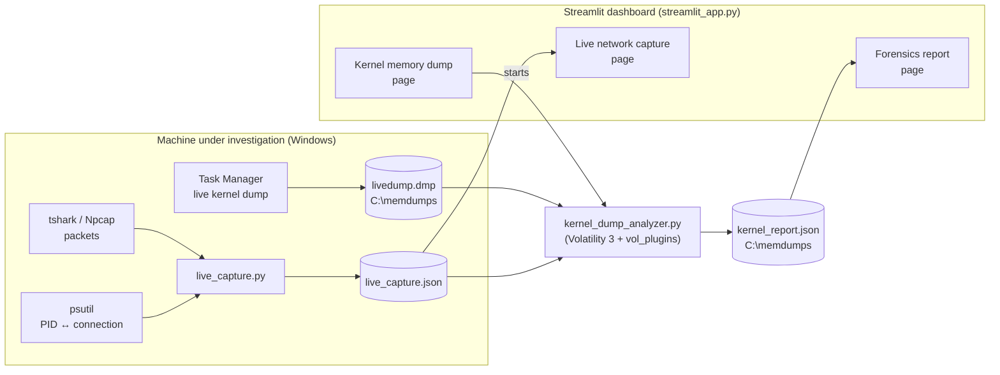
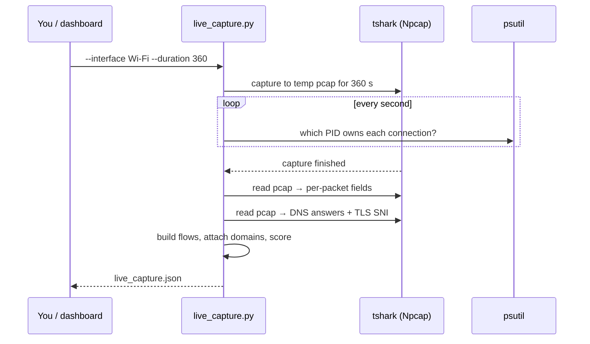
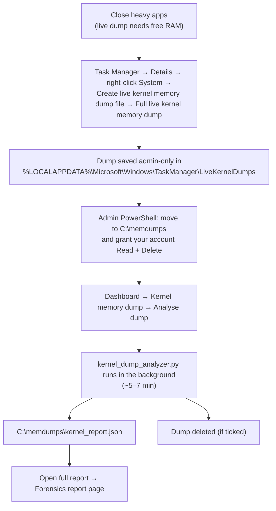

# Cryptojacking Detection — Project Guide

Detecting cryptojacking on a real Windows machine by combining **memory forensics**
(what is running, and from what kind of memory) with **network analysis** (what the
machine is talking to, and how).

This guide covers how the project fits together, what every component does, how to
run a capture end to end, and how to read the results.

---

## Contents

1. [The idea in one page](#1-the-idea-in-one-page)
2. [Architecture and data flow](#2-architecture-and-data-flow)
3. [Setup](#3-setup)
4. [Components](#4-components)
5. [Detection signals and scoring](#5-detection-signals-and-scoring)
6. [How the live network capture works](#6-how-the-live-network-capture-works)
7. [How the kernel memory dump analysis works](#7-how-the-kernel-memory-dump-analysis-works)
8. [Running a full demo](#8-running-a-full-demo)
9. [Analysing the results](#9-analysing-the-results)
10. [Privacy and data handling](#10-privacy-and-data-handling)
11. [Limitations](#11-limitations)
12. [Troubleshooting](#12-troubleshooting)
13. [File reference](#13-file-reference)

---

## 1. The idea in one page

Cryptojacking malware secretly uses a victim's CPU to mine cryptocurrency. To do that
it has to do two things that leave evidence:

| It must… | Evidence it leaves | Where we look |
|---|---|---|
| **Run hashing code**, often injected into memory rather than loaded from a file on disk | A thread whose code lives in *private, executable* memory (not a mapped `.exe`/`.dll`) **and** that burns far more CPU than other threads | Memory dump |
| **Talk to a mining pool** to receive work and submit results | Long-lived connections with small, regular packets ("Stratum" protocol), often to known pool ports/domains | Network capture |

Each signal on its own is noisy:

* Many legitimate programs (browsers, Electron apps, .NET, security software) create
  **executable + writable memory** for just-in-time compiled code.
* Many legitimate programs keep **long-lived, low-traffic connections** (HTTPS
  keep-alives, chat, sync clients).

The project's core contribution is to **bind signals together** so that only behaviour
matching *several* independent indicators is flagged:

* **Thread binding** (memory): flag a thread only when it both runs from unbacked
  memory *and* consumes abnormal CPU — not just "this process has an RWX region".
* **Cross-category matching**: boost a process when memory evidence and network
  evidence point at the same PID.

Measured on a real laptop dump (Section 9.4), RWX-region detection alone raised
17 alarms to find 1 planted miner (precision 0.06); thread binding raised exactly 1
(precision 1.00) with no loss of recall.

---

## 2. Architecture and data flow



Two pipelines feed one dashboard:

**Network pipeline** — `live_capture.py` captures packets with tshark while polling
which process owns each connection. It writes `live_capture.json`, which the
*Live network capture* page scores and visualises.

**Memory pipeline** — Task Manager writes a kernel-only memory dump.
`kernel_dump_analyzer.py` opens it with Volatility 3, runs every memory check in one
pass, optionally folds in a `live_capture.json` taken at the same time, and writes
`kernel_report.json`. The *Forensics report* page visualises that report and measures
detection accuracy.

Both pipelines use the same scoring code (`network_correlator.score_connection`,
`heuristic_analyzer` scoring, `thread_binding.bind_threads`, `merge_reports.merge`), so
a finding means the same thing wherever it appears.

---

## 3. Setup

### Software

| Requirement | Why | Notes |
|---|---|---|
| Windows 10/11 (x64) | Live kernel dumps, Npcap | Tested on Windows 11 build 26300 |
| Python 3.11+ | All scripts | Tested on 3.13.4 |
| Python packages | `pip install -r requirements.txt` | streamlit, pandas, plotly, psutil, volatility3 (pyshark optional) |
| Wireshark with **Npcap** | Packet capture (`tshark`) | Found automatically on PATH or in common install folders; or pass `--tshark` |
| Internet access (first run) | Volatility downloads Windows symbol files from Microsoft | Cached afterwards |
| Free disk on `C:` | Kernel dumps are ~2 GB | Dumps are stored in `C:\memdumps` |

### Start the dashboard

```powershell
pip install -r requirements.txt
streamlit run streamlit_app.py
```

The browser opens at `http://localhost:8501`. The sidebar switches between the three
pages: **Forensics report**, **Live network capture**, **Kernel memory dump**.

---

## 4. Components

### 4.1 Overview

| File | Pipeline | Role |
|---|---|---|
| `live_capture.py` | Network | Captures live traffic + PID map + domains; scores it; CLI and library |
| `network_correlator.py` | Network | The network heuristic (`score_connection`) and connection ↔ flow matching |
| `pcap_to_sqlite.py` | Network | Flow aggregation (`flows_to_rows`) and the SQLite flow schema; CLI for existing pcaps |
| `vol_plugins/kernel_bitmap_dump.py` | Memory | Volatility extension that reads Task Manager's dump format |
| `kernel_dump_analyzer.py` | Memory | One-pass analysis of a kernel dump → `kernel_report.json` |
| `heuristic_analyzer.py` | Memory | Process and memory-region scoring rules; also a CLI for full raw dumps (WinPmem) |
| `thread_binding.py` | Memory | The thread-binding algorithm (unbacked + high CPU) |
| `merge_reports.py` | Both | Merges memory, network and thread findings; applies the cross-category boost |
| `evaluate.py` | Both | Per-signal TP/FP/FN/TN, precision, recall, FPR |
| `streamlit_app.py` | Dashboard | Main app, *Forensics report* page, accuracy section |
| `live_view.py` | Dashboard | *Live network capture* page |
| `memory_view.py` | Dashboard | *Kernel memory dump* page (guided capture + background analysis) |
| `rwx_demo.py` | Test | Harmless process that reproduces the injected-miner memory pattern |

### 4.2 Network components

**`live_capture.py`** does three things at once during a capture window (default
360 s):

1. Runs `tshark` to record packets to a temporary pcap.
2. Every second, asks Windows (via `psutil`) which process owns each open connection —
   the live equivalent of Volatility's `netscan`.
3. After capture, extracts flows plus DNS answers and TLS server names (SNI) from the
   pcap, so connections can be labelled with domain names.

It then writes one JSON file (`live_capture.json`) and can also write a
`network_findings.json`. Details in [Section 6](#6-how-the-live-network-capture-works).

**`network_correlator.py`** holds the network heuristic. `score_connection()` takes a
connection (remote port, remote domain) and its flow statistics and returns a 0–100
score with human-readable flags. `correlate_connections()` matches each
process-owned connection to its flow — first by the exact local port, then by
remote address — and scores it.

**`pcap_to_sqlite.py`** defines the flow table schema and `flows_to_rows()`, which turns
per-packet sizes and timestamps into flow statistics (packet count, bytes, average
packet size, duration, packets per minute). It can also be run on an existing pcap
(`python pcap_to_sqlite.py --pcap file.pcap`), which requires `pyshark`.

### 4.3 Memory components

**`vol_plugins/kernel_bitmap_dump.py`** — Task Manager writes Windows crash-dump
*type 6* ("kernel bitmap dump"). Volatility 3 (2.28.2) only supports types 1 and 5.
Type 6 has the same on-disk layout as type 5 — a bitmap of which physical pages are
present, followed by those pages — it just contains kernel pages only. This small
extension registers a layer that accepts type 6 and reuses Volatility's type-5 reader.
It is loaded automatically by `kernel_dump_analyzer.py` (and with `vol -p vol_plugins`
on the command line).

**`kernel_dump_analyzer.py`** — opens the dump **once** (each separate `vol` command
would repeat several minutes of setup) and runs:

| Stage | What it does |
|---|---|
| Load | Detect the dump format, find the kernel, load symbols (first run downloads them) |
| `pslist` | Walk the kernel's active-process list |
| `psscan` | Scan memory for process structures, including unlinked/exited ones |
| VAD scan | For every running process, walk its memory-region tree (VADs) and record executable+writable private regions |
| Thread walk | For every thread: start address and accumulated CPU cycles |
| Thread binding | Run `thread_binding.bind_threads()` |
| Merge | Optionally score a live capture; merge everything with `merge_reports.merge()` |

Typical run time on a 2 GB dump: **5–7 minutes** (≈30 s load once symbols are
cached, ≈4 min process scan, ≈2 min region/thread walk). Progress is written to a JSON
file that the dashboard polls. With `--delete-dump`, the analysis runs in a child
process and the dump is deleted once that process has exited (Volatility keeps the
file open until then).

**`heuristic_analyzer.py`** — provides the scoring rules reused above
(`score_process`, `score_malfind_hit`). It is also a standalone CLI for **full** raw
memory images (e.g. from WinPmem), where Volatility's own `malfind` can read page
contents: `python heuristic_analyzer.py --image memdump.raw --out report.json`.

**`thread_binding.py`** — the thread-level algorithm (Section 5.3). Pure Python
binding logic (`bind_threads`) plus an extraction function for running directly on a
dump.

**`merge_reports.py`** — combines process, memory-region, thread and network findings
into one report and adds the cross-category boost (Section 5.4).

### 4.4 Dashboard

**`streamlit_app.py`** — the sidebar router and the *Forensics report* page. By default
it loads `C:\memdumps\kernel_report.json`.

**`memory_view.py`** — the *Kernel memory dump* page: step-by-step instructions, dump
discovery and permission checks, an optional live capture to correlate, and a
background analysis job with a progress bar. The job keeps running if you refresh or
switch pages.

**`live_view.py`** — the *Live network capture* page: upload a capture JSON, upload a
pcap, or start a capture from the page.

### 4.5 Test fixture: `rwx_demo.py`

A harmless stand-in for an injected miner. It allocates a small block of private
`PAGE_EXECUTE_READWRITE` memory in **its own process**, writes a 5-byte infinite loop
into it, and starts a thread there. That thread therefore *starts in unbacked
executable memory* and *uses 100% of one CPU core* — exactly the pattern thread
binding looks for. It has no network activity, touches no other process, and exits
when its timer ends.

```powershell
python rwx_demo.py 900     # run for 900 seconds; prints its PID
```

---

## 5. Detection signals and scoring

All scores are 0–100 (capped). Higher means more suspicious.

### 5.1 Network: mining-like connection (`network_correlator.score_connection`)

| Indicator | Condition | Points |
|---|---|---|
| Known mining port | Remote port in {3333, 4444, 5555, 7777, 14444, 14433} | +40 |
| Mining domain | Domain contains `pool`, `xmr`, `monero`, `nicehash` or `stratum` | +40 |
| Long-lived | Flow observed for ≥ 300 s | +30 |
| Small uniform packets | Average packet ≤ 300 bytes | +20 |
| Steady heartbeat | 5–30 packets per minute | +10 |

Interpretation:

* **10–30** — weak, typical of HTTPS keep-alives. Hidden by default in the live view.
* **≥ 40** — shown in the live view and passed into merged reports.
* **≥ 80** — counted as "mining traffic" by the accuracy evaluation.

### 5.2 Memory: processes and regions

**Processes** (`heuristic_analyzer.score_process`), comparing `pslist` with `psscan`:

| Indicator | Condition | Points |
|---|---|---|
| Hidden process | Found by scanning but missing from the OS process list, and **not** exited | +60 |
| Orphaned process | No valid parent (and not a known root process) | +25 |

Processes that simply exited also linger in `psscan`; the kernel analyzer counts those
separately (`exited_process_count`) instead of flagging them as hidden.

**Executable + writable memory regions** (`score_malfind_hit`):

| Indicator | Points |
|---|---|
| Region is executable+writable and private (or an unusual mapped region) | 50 (base) |
| Protection is `PAGE_EXECUTE_READWRITE` | +30 |
| Contains an `MZ` header (a hidden PE file) | +20 — *not available on kernel-only dumps* |

On kernel-only dumps these findings come from the VAD scan (`detector:
vad_scan`) rather than Volatility's `malfind` plugin, so a private RWX region scores 80.

### 5.3 Memory: thread binding (`thread_binding.bind_threads`)

For each user-mode thread:

1. **Unbacked?** — does its start address lie inside *private executable* memory with
   no file behind it? (Kernel threads and threads in mapped images are "backed".)
2. **High CPU?** — is its accumulated CPU-cycle count an outlier? The test is
   `cycles ≥ median + 3 × MAD` (median absolute deviation). On real dumps it is
   applied to **log10(cycles)**, because thread CPU on a real machine is extremely
   skewed — most threads are near-idle. On the test laptop the resulting threshold was
   ≈135 billion cycles (≈45 s of CPU).

| Unbacked | High CPU | Verdict | Score |
|---|---|---|---|
| ✓ | ✓ | **HASHING_THREAD** | 50 + 30 + 20 = 100 |
| ✓ | ✗ | injected_thread | 50 |
| ✗ | ✓ | busy_thread | 30 |
| ✗ | ✗ | clean (not reported) | — |

### 5.4 Cross-category boost (`merge_reports.merge`)

If a PID has a memory finding (process, region or flagged thread) **and** a network
finding, its entries get **+20** (capped at 100) and the flag
`cross_category_match (memory + network)`. A hashing thread whose process also has
mining traffic gets the same boost.

---

## 6. How the live network capture works

### 6.1 Step by step



1. **Packets.** `tshark -i <interface> -a duration:<N>` writes a pcap. The pcap is
   deleted afterwards unless you pass `--pcap`.
2. **Process ownership.** While tshark runs, `psutil.net_connections()` is polled
   every second. Each connection's local/remote address, port, state and owning
   PID/process name is recorded, along with first/last seen times.
3. **Flows.** Packets are grouped per direction by
   `(src_ip, src_port, dst_ip, dst_port)` for TCP and UDP, IPv4 and IPv6. Each flow
   gets packet count, total bytes, average packet size, duration and packets/minute.
4. **Domains.** DNS responses map IP → queried name; TLS ClientHello SNI maps IP →
   server name (SNI wins when both exist). Only connections opened *during* the capture
   produce these, so start capturing before starting the activity you want to label.
5. **Scoring.** Process-owned connections are matched to their outbound flow and scored
   (Section 5.1). Flows that no tracked process owned (e.g. from a pcap upload) are
   also scored, as `(unattributed)`; for those, the side with the lower port is taken
   as the server.

### 6.2 Three ways to get data into the dashboard

| Mode | How | Process names? | Notes |
|---|---|---|---|
| **Upload capture JSON** (recommended) | Run `live_capture.py`, upload `live_capture.json` | Yes | Works from any machine |
| **Upload pcap** | Upload a `.pcap`/`.pcapng` | No | tshark must be installed where Streamlit runs |
| **Capture now (local)** | Pick interface + duration, press *Start capture* | Yes | Captures the machine **running Streamlit**, not the viewer's |

A web page cannot capture packets itself — browsers have no access to network adapters
or process tables — so "Capture now" works only because Streamlit runs on the same
computer as the browser.

### 6.3 Commands

```powershell
python live_capture.py --list-interfaces
python live_capture.py --interface "Wi-Fi" --duration 360 --out live_capture.json
# optional: --pcap keep.pcap   --findings-out network_findings.json   --tshark "C:\Program Files\Wireshark\tshark.exe"
```

### 6.4 Reading the live view

* **Metrics row** — packets, flows, process-attributed connections, findings at or
  above the minimum score, highest score.
* **Minimum score slider** (default 40) — hides weak keep-alive noise.
* **Scatter: flow duration vs packets/minute** — mining traffic sits at long duration
  with a steady, low packet rate.
* **Tables** — findings with flags; all flows; the process ↔ connection map.
* **Download** — `network_findings.json` (merge format) and the raw capture JSON.

---

## 7. How the kernel memory dump analysis works

### 7.1 Why a kernel-only dump

A normal memory dump copies **all** physical RAM (≈16 GB on the test laptop),
including passwords, browser cookies, chats and open documents. Nearly every fact the
detectors need lives in **kernel memory** instead:

| Needed for | Data | Location |
|---|---|---|
| Process lists | `_EPROCESS` records | Kernel |
| Memory-region protections | VAD tree | Kernel |
| Thread start address, CPU cycles | `_ETHREAD`, `_KTHREAD` | Kernel |
| Region *contents* (MZ check) | User pages | User memory — not captured |

So the project uses a **kernel-only live dump** (≈2 GB) created by Task Manager with
*Capture user pages* turned **off**. The only capability lost is the +20 MZ-header
bonus.

### 7.2 Workflow



The admin commands (the dashboard shows them with the right path filled in):

```powershell
New-Item -ItemType Directory -Force C:\memdumps | Out-Null
Move-Item "$env:LOCALAPPDATA\Microsoft\Windows\TaskManager\LiveKernelDumps\livedump.DMP" C:\memdumps\livedump.dmp
icacls C:\memdumps\livedump.dmp /grant "${env:USERDOMAIN}\${env:USERNAME}:(R,D)"
```

Task Manager saves dumps readable by administrators only; `R` lets the analyzer read
it without admin rights, `D` lets it delete the dump afterwards.

Command-line equivalent of the dashboard button:

```powershell
python kernel_dump_analyzer.py --dump C:\memdumps\livedump.dmp `
    --out C:\memdumps\kernel_report.json `
    --live-capture live_capture.json --delete-dump
```

### 7.3 What the report contains

| Key | Content |
|---|---|
| `summary` | Counts: processes (pslist/psscan), exited, hidden, RWX regions, threads examined, flagged threads, network hits, cross-category matches |
| `process_findings` | Hidden/orphaned processes with flags and scores |
| `malfind_findings` | Executable+writable regions: PID, process, address range, size, protection, backing, score |
| `hashing_thread_findings` | Flagged threads: PID, TID, verdict, start address, CPU cycles, reasons, score |
| `network_findings` | Scored connections from the live capture (score ≥ 40) |
| `process_list` | Every running process (PID + name), used to label ground truth |
| `network_observed_pids` | Processes that made connections during the capture |
| `analysis_notes` | What a kernel-only dump can and cannot show |

### 7.4 Network data and `netscan`

Volatility's `windows.netscan` would normally recover connections from the dump
itself. On Windows 11 24H2 and later (build ≥ 26100) it finds the connection objects
but has no structure layout for them and returns nothing (Volatility 2.28.2). The
project therefore takes the PID ↔ connection map from a **live capture taken at the
same time** as the dump. PIDs match because both come from the same running system.

---

## 8. Running a full demo

Goal: show the detector catching a miner-like process on a real machine, and measure
its accuracy. Total time ≈ 15–20 minutes.

| Time | Step |
|---|---|
| Before | Delete any old dump: `Remove-Item C:\memdumps\livedump.dmp` (admin). Close browsers, IDEs other than the one you need, Steam. |
| 0:00 | Terminal 1: `streamlit run streamlit_app.py` |
| 0:00 | Terminal 2: `python rwx_demo.py 900` — **note the PID it prints**, leave it running |
| 0:00 | *(optional)* Terminal 3: `python live_capture.py -i "Wi-Fi" -d 360 --out live_capture.json` |
| ~3:00 | Task Manager → **System** → *Create live kernel memory dump file* → *Full live kernel memory dump*. Wait for "saved". |
| ~4:00 | Admin PowerShell: move + `icacls` commands (Section 7.2). Only now stop `rwx_demo` (Ctrl+C). |
| ~6:00 | *(if capturing)* wait for `live_capture.py` to finish |
| ~6:00 | Dashboard → **Kernel memory dump** → choose dump → network: *None* or *live_capture.json* → **Analyse dump** |
| ~12:00 | **Open full report** → scroll to *Detection Accuracy* → enter the `rwx_demo` PID |

Why the timing matters:

* `rwx_demo` must still be running **when the dump is taken** — a dump shows only what
  is in memory at that instant.
* Waiting ~3 minutes lets its spinning thread accumulate enough CPU cycles to stand
  out from other threads.

Expected result: `python.exe` with your PID appears in **Hashing Threads** with verdict
**HASHING_THREAD** (score 100) and in **Flagged Memory Regions** with a 4 KB
`PAGE_EXECUTE_READWRITE` private region.

---

## 9. Analysing the results

### 9.1 Forensics report page — top to bottom

| Section | What it shows | How to read it |
|---|---|---|
| Analysis notes | Caveats for kernel-only dumps | Context, not findings |
| Summary metrics | Process counts, hidden processes, RWX hits, flagged threads, network hits, cross-category matches | A quick sense of scale |
| Process anomalies | Bar chart + table of hidden/orphaned processes | Any *hidden* process is serious; expect none on a clean machine |
| Flagged memory regions | Bar chart: number of RWX regions per process (colour = highest score) + full table | Expect JIT-heavy apps here (browsers, Phone Link, security tools). On its own this is **not** proof of compromise |
| Hashing threads | Scatter of thread verdict vs CPU cycles + table | **HASHING_THREAD** is the key finding; `busy_thread` = heavy but legitimate code; `injected_thread` = unbacked but not CPU-heavy |
| Network anomalies | Scatter (duration vs packets/min) + table | High scores with mining ports/domains are the strongest network evidence |
| Top priority alerts | Ten highest-scoring findings across all categories | Where to start an investigation |
| Detection accuracy | Precision / recall / FPR per signal (below) | How good each signal is, measured against labels |

### 9.2 Detection accuracy: how it is computed

1. **Label the dump.** Enter the PID(s) you know are malicious (e.g. the `rwx_demo`
   PID). Every other process running in the dump is counted as benign.
2. **Each signal flags a set of PIDs:**

   | Signal | A PID counts as flagged when… |
   |---|---|
   | process (pslist/psscan) | it has a process finding |
   | malfind (RWX region) | it has at least one flagged memory region |
   | thread-binding | it has a **HASHING_THREAD** |
   | ≥2 memory signals agree | at least two of the three memory signals flag it |
   | network (mining traffic) | it has a network finding with score ≥ 80 |
   | Memory AND network agree | at least one memory signal **and** the network signal flag it |

3. **Each process is counted once** per signal:

   | | Flagged | Not flagged |
   |---|---|---|
   | **Malicious** | TP (caught) | FN (missed) |
   | **Benign** | FP (false alarm) | TN (correctly ignored) |

4. **Metrics:**

   | Metric | Formula | Question it answers |
   |---|---|---|
   | Alarms raised | TP + FP | How many processes would an analyst have to check? |
   | Precision | TP / (TP + FP) | When it raises an alarm, how often is it right? |
   | Recall | TP / (TP + FN) | Of the real threats, how many did it catch? |
   | False-positive rate | FP / (FP + TN) | What share of normal programs does it falsely flag? |
   | Accuracy | (TP + TN) / all | Shown only in *All counts* — see below |

   "—" (or None) means undefined: precision with no alarms raised, recall with no
   malicious process in the evaluated population.

### 9.3 Why the techniques are evaluated separately

Memory forensics and network analysis observe different things, so they are scored
in separate tabs and on different populations:

* **🧠 Memory forensics** — evaluated on every labelled process in the dump.
* **🌐 Network analysis** — evaluated only on processes that made connections during
  the capture (`network_observed_pids`). A process that never used the network can't
  be detected *or* falsely flagged by network analysis, so including it would inflate
  the true-negative count. If the malicious process made no connections, recall is
  shown as undefined.
* **🔗 Combined** — not a comparison between techniques, but a test of whether
  independent evidence from both agrees on the same process.

**Accuracy is not a headline metric** because of class imbalance: with 1 malicious and
404 benign processes, a detector that flags nothing scores 404/405 ≈ 0.998. Use
precision, recall and FPR instead.

### 9.4 Worked example (test laptop, 1 planted `rwx_demo`, 405 processes)

| Technique | Signal | TP | FP | FN | TN | Precision | Recall | FPR |
|---|---|---|---|---|---|---|---|---|
| memory | process (pslist/psscan) | 0 | 0 | 1 | 404 | — | 0.00 | 0.00 |
| memory | malfind (RWX region) | 1 | 16 | 0 | 388 | 0.06 | 1.00 | 0.04 |
| memory | thread-binding (HASHING_THREAD) | 1 | 0 | 0 | 404 | 1.00 | 1.00 | 0.00 |
| memory | ≥2 memory signals agree | 1 | 0 | 0 | 404 | 1.00 | 1.00 | 0.00 |
| network | network (mining traffic) | 0 | 0 | 0 | 13 | — | — | 0.00 |
| combined | Memory AND network agree | 0 | 0 | 1 | 404 | — | 0.00 | 0.00 |

Reading it:

* **Process check** missed `rwx_demo` — expected, it detects *hiding*, which the demo
  doesn't do — and raised no false alarms.
* **RWX regions** caught the demo but also flagged 16 legitimate programs: 1 real alarm
  in 17 (precision 0.06), 4% of normal programs falsely flagged.
* **Thread binding** caught the demo with **zero** false alarms out of 5,007 threads.
* **≥2 memory signals** removed all 16 RWX false positives, because none of those
  programs had a second memory signal.
* **Network** had no malicious process to evaluate (the demo has no network activity);
  it raised no false alarms among the 13 network-using processes.
* **Combined** misses the demo for the same reason — that row needs a test that also
  generates mining-like traffic.

**Headline:** binding unbacked execution to abnormal CPU at the thread level cut alarms
from 17 to 1 and the false-positive rate from 4% to 0%, with recall unchanged.

### 9.5 Reporting results responsibly

* **One labelled sample is a demonstration, not a statistic.** Repeat runs (different
  durations, several `rwx_demo` instances, different machine load) and report totals.
* **Sanity check the labels.** Entering a random benign PID should make every signal's
  recall 0 and turn thread binding's alarm into a false positive.

---

## 10. Privacy and data handling

| Data | Sensitivity | Where it lives | In git? |
|---|---|---|---|
| Kernel dump (`livedump.dmp`) | **High** — process command lines, connection details, file-cache fragments, kernel-held keys (e.g. BitLocker) | `C:\memdumps`, deleted after analysis by default | Never (`*.dmp` ignored) |
| Raw pcap | **High** — packet contents | Temp folder, deleted unless `--pcap` | Never (`*.pcap`, `*.pcapng` ignored) |
| `live_capture.json` | Medium — IPs, process names, visited domains | Project folder | Never (`live_capture*.json` ignored) |
| `kernel_report.json` | Low–medium — process names, PIDs, addresses, connection IPs | `C:\memdumps` (the page refuses paths inside the project) | Never (`kernel_report*.json` ignored) |
| `C:\memdumps\kernel_job*.json`, `kernel_analysis.log` | Low–medium (the job capture copy contains the live capture) | `C:\memdumps` | Outside the repo |

Rules of thumb:

* Keep dumps out of OneDrive and out of the project folder. The dashboard warns if a
  dump is inside a OneDrive path.
* Delete dumps after analysis (default). If automatic deletion fails, run
  `Remove-Item C:\memdumps\livedump.dmp` in an Administrator PowerShell.
* Before a live demo, close apps you don't want to appear in process lists or captured
  domains.

---

## 11. Limitations

| Limitation | Effect | Mitigation |
|---|---|---|
| Single snapshot | CPU is cycles accumulated since each thread started; a miner started seconds before the dump may not stand out | Let suspicious activity run a few minutes before dumping |
| Thread binding targets injected/fileless code | A miner run as a normal `.exe` executes from file-backed code → `busy_thread`, not `HASHING_THREAD` | Network evidence covers this case |
| Kernel-only dump | No user page contents → no MZ-header check | Use a full WinPmem dump + `heuristic_analyzer.py` when contents matter |
| `netscan` on Windows 11 24H2+ | No connections from the dump itself | Correlate with a simultaneous live capture |
| Live kernel dumps need free RAM | Windows aborts with "system memory pressure" on a loaded machine | Close heavy apps (aim for ≥ 4 GB available) |
| Live capture polling | Connections that open and close between 1-second polls have no PID | Most mining connections are long-lived |
| Domains only for new connections | Connections opened before the capture have no DNS/SNI name | Start the capture before the activity |
| Long-lived threshold is 300 s | Shorter captures can't trigger it | Capture ≥ 6 minutes (default 360 s) |
| Small labelled sample | Metrics from one planted process | Repeat runs; report aggregates |

---

## 12. Troubleshooting

| Problem | Cause / fix |
|---|---|
| "Memory dump aborted due to system memory pressure" | Not enough free RAM. Close browsers/IDEs/games; check Task Manager → Performance → Memory |
| Dashboard shows "🔒 admin-only" | Run the `Move-Item` + `icacls` commands in an Administrator PowerShell, then refresh |
| `Move-Item`: file already exists | Delete the previous dump first |
| `vol` (run by hand) can't read a Task Manager dump | Add the extension: `vol -p vol_plugins -f C:\memdumps\livedump.dmp windows.pslist` (the analyzer loads it automatically) |
| First analysis very slow | Volatility downloading symbols (needs internet); later runs are faster |
| Demo PID "Not running in this dump" | `rwx_demo` exited before the dump was taken; restart it and keep it running through the dump |
| Demo PID shows `busy_thread` / `injected_thread` instead of HASHING_THREAD | `injected_thread`: it wasn't a CPU outlier yet — wait longer before dumping. `busy_thread`: its start address wasn't in private executable memory |
| `tshark not found` | Install Wireshark with Npcap, or pass `--tshark "C:\Program Files\Wireshark\tshark.exe"` |
| Capture shows 0 packets | Wrong interface (`--list-interfaces`), or Npcap requires admin — run the terminal as Administrator |
| All live scores ≤ 30 | Normal browsing; mining-like traffic needs long, steady connections |
| Accuracy section says the report has no process list | Report made by an older version — re-analyse the dump |

---

## 13. File reference

### Outputs

| File | Produced by | Default location |
|---|---|---|
| `live_capture.json` | `live_capture.py`, Live capture page | `--out` (project folder by default) |
| `network_findings.json` | `live_capture.py --findings-out`, Live page download | Where you choose |
| `livedump.dmp` | Task Manager | Moved to `C:\memdumps` |
| `kernel_report.json` | `kernel_dump_analyzer.py` | `C:\memdumps` |
| `kernel_progress.json`, `kernel_job.json`, `kernel_analysis.log`, `kernel_job_capture.json` | Kernel memory dump page | `C:\memdumps` |

### Command-line reference

```text
live_capture.py        --list-interfaces
                       --interface/-i NAME  --duration/-d SECONDS (360)  --out FILE
                       [--pcap FILE] [--findings-out FILE] [--tshark PATH]

kernel_dump_analyzer.py --dump FILE --out FILE [--live-capture FILE] [--delete-dump]

heuristic_analyzer.py  --image RAW_DUMP --out FILE          (full raw dumps, e.g. WinPmem)
thread_binding.py      --image DUMP --out FILE
merge_reports.py       --report FILE --network FILE [--threads FILE] --out FILE
network_correlator.py  --netscan FILE --db flows.db --out FILE
pcap_to_sqlite.py      --pcap FILE --db flows.db
evaluate.py            --report FILE --truth FILE           (truth: {"malicious_pids": [...], "benign_pids": [...]})
rwx_demo.py            [SECONDS]                            (default 60)
```
